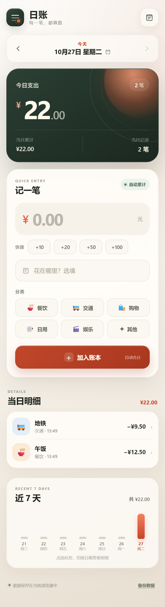

# 日账 · 每日花销记录



一个为手机浏览器设计的轻量记账应用。每添加一笔花销，当天总额、笔数、当月累计和近 7 天图表都会自动更新。

## 在线使用

手机浏览器直接打开：

**https://lijiade-libiao.github.io/rizhang/**

不需要和电脑连接同一个 Wi-Fi，也不需要保持电脑开机。只要手机能正常访问公网，就可以打开并使用。

- iPhone：Safari 打开后，点“分享” → “添加到主屏幕”
- Android：Chrome 打开后，点菜单 → “添加到主屏幕” / “安装应用”
- 安装后可像普通 App 一样从桌面启动，已访问的页面也支持离线打开

## 本地备用方式

1. 双击 `启动账本.bat`，保持弹出的窗口不要关闭。
2. 电脑浏览器会自动打开 `http://localhost:8080/`。
3. 手机和电脑连接同一个 Wi-Fi，然后在手机浏览器打开启动窗口里显示的地址，例如 `http://10.1.6.48:8080/`。
4. 想更像 App 时，可以添加到手机桌面：
   - iPhone：Safari → 分享 → 添加到主屏幕
   - Android：Chrome 菜单 → 添加到主屏幕 / 安装应用

如果手机打不开，请先确认两台设备在同一 Wi-Fi，并在 Windows 防火墙提示时允许 Windows PowerShell 访问网络。

## 已实现

- 输入金额后点“加入账本”，当天总额立即自动累计
- 6 个花销分类，支持备注和快捷金额
- 按日期查看历史记录，近 7 天柱形图可切换日期
- 点按任意记录可修改金额、分类、备注和日期，也可删除
- 自动统计当月累计与当月记录数
- 金额以“分”为单位存储，避免浮点小数误差
- 使用 localStorage 保存在当前浏览器
- 支持 JSON 导出、合并导入和数据清空
- PWA 清单、应用图标和离线缓存

## 数据说明

账目保存在**当前手机浏览器**的本地存储中，不会上传到服务器。因此：

- 换手机、清理浏览器数据或使用无痕浏览前，请先点右上角“数据与备份” → “导出备份”。
- 同一台设备的不同浏览器之间数据不互通。
- 在线版通过 HTTPS 打开，可完整启用 Service Worker 离线缓存；“添加到主屏幕”后离线也能查看和继续记账。
- 本地局域网版的数据和在线版数据属于不同的浏览器存储空间，请固定使用其中一个地址。

## 手动启动与修改端口

如果自动启动失败，可以在本目录运行：

```powershell
powershell -NoProfile -ExecutionPolicy Bypass -File .\serve.ps1
```

使用其他端口：

```powershell
powershell -NoProfile -ExecutionPolicy Bypass -File .\serve.ps1 -Port 8090
```

服务只提供网页所需的 HTML、CSS、JavaScript、图标和 PWA 文件，不会暴露服务器脚本。
